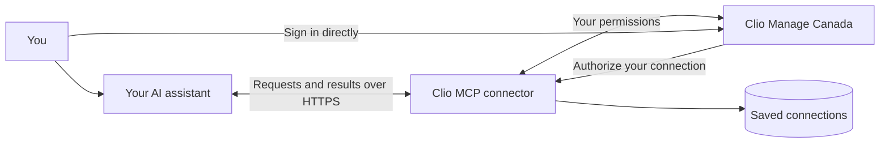

# Clio MCP for Canada

Connect an AI assistant to Clio Manage to find records and carry out work on your behalf. Ask for open matters, find a contact, create a task, or update a note. MCP (Model Context Protocol) is the connection between your assistant and Clio.

## Choose how to use it

| Option | Who runs it? | Start here |
| --- | --- | --- |
| **Use our free hosted connector** | We run the server in Toronto | [Connect below](#use-the-hosted-service) |
| **Run your own cloud server** | Your firm or its IT provider | [Cloud deployment guide](docs/cloud-deployment.md) |
| **Run it on your computer** | You, on your own computer | [Local setup guide](docs/local-deployment.md) |

## Use the hosted service

You need a **Canadian Clio Manage account** and an AI assistant that supports remote MCP connections with browser sign-in. Each person connects using their own Clio login. No invitation or separate password is required.

1. Add a remote MCP connection in your AI assistant using this server URL:

   ```text
   https://highvizcto-clio-mcp-ca.fly.dev/api/auth/mcp
   ```

2. Follow the sign-in prompt. Sign in on Clio's page and review the requested access. Never paste your Clio password into a chat.
3. Try **“List up to five open matters. Do not change anything.”** Compare the results with Clio.
4. Before asking the assistant to change real records, try creating and updating a fictional test record and check the result in Clio.

The connection settings and menus depend on your AI assistant. For Codex setup, see the [connection instructions](hosted/README.md#codex-connection-and-live-acceptance).

### What you can ask

- “Find the contact details for Jane Smith.”
- “List my open matters.”
- “Show the notes for this matter.”
- “Create a task to follow up with this client on Friday.”
- “Add this summary as a note on the matter.”
- “Delete the fictional contact we created for testing.”

The connector can read matters, contacts, notes, documents, tasks, calendar entries, activities, and billing information, and create or update supported records. It can also **delete contacts, matters, and notes** when write access is granted. Your Clio permissions still apply. Review proposed changes before approving them; if an operation times out, check Clio before asking the assistant to repeat it.

Document upload is available in the local version only. Hosted document upload and audit export are not currently available.

### Disconnect

Open the [connection page](https://highvizcto-clio-mcp-ca.fly.dev/connected) in your signed-in browser and choose **Disconnect Clio** to remove your saved connection. To revoke the application's Clio authorization as well, remove it in Clio. Removing the connector from your AI assistant alone does not revoke its Clio authorization.

## How it works



**You sign in with Clio.** The connector does not receive your Clio password. It saves encrypted access credentials so it can carry out requests on your behalf.

**Each request uses the connected person's credentials.** The server checks which user owns the connection, and Clio enforces that user's permissions. The hosted service shares a server and database across users and firms.

**Clio records pass through the connector to your AI assistant.** The connector's database holds account and connection information, rather than a copy of your matters and documents. The server also produces operational logs. Review your AI provider's data-handling terms before using client information.

**Our hosted server is in Toronto.** Your AI provider may process data elsewhere. Hosting the connector yourself changes who operates it; running it locally does not also run the AI model locally.

For your IT provider or a technical security review, see the [architecture, security controls, and testing documentation](hosted/README.md).

## Support

Email [nick@highvizcto.com](mailto:nick@highvizcto.com) for help, or [open an issue](https://github.com/nickwang0808/clio-mcp/issues) for bugs and feature requests. Include the AI client you use and a description of the problem, without passwords, credentials, or client records. Report security concerns privately by email; see [SECURITY.md](SECURITY.md).

This is an independently maintained project, not an official Clio product. It is available under the [MIT license](LICENSE), with original copyright notices preserved.
