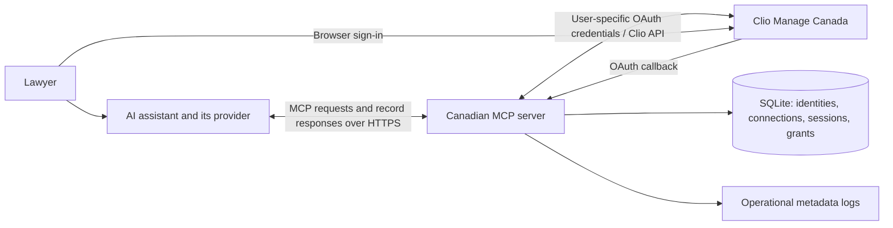

# Clio MCP for Canada

Connect an AI assistant to Clio Manage to find records and carry out work on your behalf. Ask for open matters, find a contact, create a task, or update a note. MCP (Model Context Protocol) is the connection between your assistant and these tools.

This fork is maintained by [Nick Wang](https://github.com/nickwang0808). The Canadian hosted service is offered free to introduce firms to the maintainer's work. You can also run the code on infrastructure you control. Original MIT license attribution is preserved below.

**Current status:** an early hosted service with open signup for Canadian Clio accounts. Automated isolation tests and one-account live Canadian CRUD have passed. Live testing across multiple firms and ChatGPT retesting remain outstanding. This project does not claim an independent security audit, compliance certification, or availability guarantee.

## Choose how to use it

| Option | Who runs the connector and stores its credentials? | Start here |
| --- | --- | --- |
| **I host — use our service** | The project maintainer, on Fly.io in Toronto | [Connect below](#use-the-hosted-service) |
| **You host — your own cloud server** | Your firm or its IT provider, in its own Fly account | [Cloud deployment guide](docs/cloud-deployment.md) |
| **Your local machine hosts** | Your computer, under your operating-system account | [Local setup guide](docs/local-deployment.md) |

The cloud options use the same Canadian multi-user application. The local option uses the existing single-user stdio application, with a different authentication and storage design. Installing a connector in an AI client is not the same as hosting a server yourself.

## Use the hosted service

You need a Canadian Clio Manage account and an AI client that supports remote MCP with OAuth. Each person connects using their own Clio login. No invitation or separate service password is required; Clio app access and permissions still apply.

1. Add a remote MCP connection in your AI client, using this server URL:

   ```text
   https://highvizcto-clio-mcp-ca.fly.dev/api/auth/mcp
   ```

2. Start the client's sign-in flow. Sign in on Clio's page, then review the client and requested access on the consent screen. Never paste your Clio password or developer secret into a chat.
3. Return to the client and try: **“List up to five open matters. Do not change anything.”** Compare the results with Clio.
4. Before using writes, test with a clearly labeled fictional record. Check the result in Clio before requesting further changes.

**Codex:** this repository includes the connection in [`.codex/config.toml`](.codex/config.toml). Open it as a trusted project, run `codex mcp login clio_canada` from the repository, complete browser login, and reload MCP connections if needed. For setup outside this repository, see the [official Codex MCP instructions](https://learn.chatgpt.com/docs/extend/mcp).

Other clients use the same URL. Their menus and account requirements differ. Codex login, discovery, and live contact/matter/note CRUD were verified on **October 27, 2026**; we do not yet claim equivalent end-to-end verification for ChatGPT or Claude.

To disconnect, open the service's [connection page](https://highvizcto-clio-mcp-ca.fly.dev/connected) in your signed-in browser and choose **Disconnect Clio**. This removes the service's saved connection and invalidates its grants. Revoke the application's authorization in Clio as well if you want to revoke upstream access. Removing an AI client's connector alone is not the same as revoking Clio authorization.

## What it can do

| Capability | Hosted / your cloud | Local |
| --- | --- | --- |
| Tool total with writes enabled | 40 tools | 45 tools |
| Find matters, contacts, notes, documents, folders, tasks, calendar, users, activities, and billing information | Yes | Yes |
| Create and update supported records | Yes | Yes |
| Delete contacts, matters, and notes | Yes | Yes |
| Upload a document | Planned: [issue #3](https://github.com/nickwang0808/clio-mcp/issues/3) | Existing tool reads a file on the local computer |
| Export connector audit metadata | Planned: [issue #2](https://github.com/nickwang0808/clio-mcp/issues/2) | Existing local export tool |
| Authentication | Browser OAuth, managed by the hosted application | Local authentication tools |

Hosted access includes **23 read tools and 17 write tools** when both scopes are granted. A `clio:read`-only grant excludes writes. A `clio:write` grant includes deletes; hiding delete tools in a client is a convenience, not a server-side permission boundary. Clio's own permissions still govern each API operation. This is not an implementation of every Clio API endpoint.

Local `READ_ONLY=true` removes all **18 Clio write tools**. See the [local guide](docs/local-deployment.md) for configuration and the [tool registry](src/tools/index.ts) for the complete inventory.

## Where the data goes



The hosted server processes Clio records in memory and returns them to your assistant. Its authentication database is not a copy of your matters or documents, but **records do pass through the server and reach your AI provider**. The database stores identity details and authentication state, including encrypted Clio credentials. Application audit output contains internal identifiers, tool name, and outcome, without tool arguments or record results.

Our hosted application and volume are in Toronto. This does not establish end-to-end Canadian residency: the AI provider, the client, and infrastructure logging have their own handling and retention. Self-hosting changes who operates the connector; it does not change your AI provider's terms. Running the connector locally does not also run the AI model locally.

## Security decisions and evidence

| Question | Design and evidence |
| --- | --- |
| Do you receive our Clio password? | No. Users authenticate with Clio. [Better Auth integration](hosted/src/auth.ts) handles browser sessions and downstream OAuth. |
| How is a user's token selected? | Requests are bound to the authenticated user and original connection. Ownership is checked around token retrieval; tool arguments cannot choose another account's credentials. See the [hosted source](hosted/src) and [technical runbook](hosted/README.md#ownership-and-lifecycle). |
| What separates firms? | Validated Canadian firm/user identities, per-connection ownership, and Clio's own permission enforcement. This is application-level isolation in a shared process/database, not a separate database or machine per firm. |
| How are credentials protected? | Better Auth encrypts stored upstream credentials and hashes downstream tokens. The encryption secret lives outside the database in deployment secrets. The application must be able to decrypt credentials to use them; this is not an operator-blind service. |
| Can an edited database defeat these checks? | Database integrity and operator access are trusted. Encryption does not independently bind a swapped credential to its rightful owner. Characterization tests document this limitation. |
| What happens on an uncertain write? | Hosted requests are not automatically replayed after a lost response. Check Clio before repeating a write to avoid duplicates. |
| What has been tested? | Offline tests use multiple users across simulated firms, overlapping record IDs, concurrent operations, permission denials, reconnects, revocation, and storage loss. One live Canadian account passed contact/matter/note create, read, update, and delete, with cleanup. |

The [hosted runbook](hosted/README.md) records test evidence and remaining work. [GitHub Actions](https://github.com/nickwang0808/clio-mcp/actions) publishes build/test results. Reproduce the offline suites without a Clio account:

```sh
docker build --target test -f hosted/Dockerfile -t clio-hosted-test .
docker run --rm --network none clio-hosted-test
```

Building downloads dependencies; the test container then runs without networking. Passing tests demonstrate the scenarios exercised, not a guarantee against every possible leak. Some passing characterization tests deliberately reproduce unresolved limitations.

### Known limitations

- A delayed upstream token refresh can overwrite a newer connection's credentials for the same user. [Issue #1](https://github.com/nickwang0808/clio-mcp/issues/1) tracks this reliability problem; it is not evidence of another user's token being substituted.
- Full live multi-firm acceptance, upstream refresh/revocation testing, additional concurrency cases, and production load testing remain incomplete.
- One server process and one SQLite volume are supported. Deployments can briefly interrupt service. Database loss requires everyone to reconnect; it does not erase records in Clio.
- Hosted audit export and document upload are unavailable. Application logs are not a complete, tamper-proof compliance audit system. The application does not define a log-retention schedule; operators must configure it.
- Prompted actions can be wrong even when authentication is correct. Review changes and the AI provider's data handling before using client records.

These are engineering controls and evidence for your firm's review. They are not a representation of legal compliance, privilege protection, or regulatory approval. Formal privacy/retention commitments and support terms have not been published here.

## Support, maintenance, and license

Use this fork's [issues](https://github.com/nickwang0808/clio-mcp/issues) for ordinary bugs and feature requests. Include the client, approximate time, tool name, and a sanitized error. Do not include credentials or client records. See [SECURITY.md](SECURITY.md) for the current security-reporting status.

This is a fork of [Oktopeak's Clio MCP](https://github.com/oktopeak/clio-mcp). Original copyright and MIT terms remain in [LICENSE](LICENSE). This fork adds the Canadian hosted service and shared CRUD changes; it is not presented as an official Clio product. Existing npm/package metadata still uses the upstream name, so follow these source-based guides to get this fork's code.

For technical review: [cloud deployment](docs/cloud-deployment.md), [local setup](docs/local-deployment.md), [hosted implementation/runbook](hosted/README.md), and [CRUD reference](docs/crud.md).
